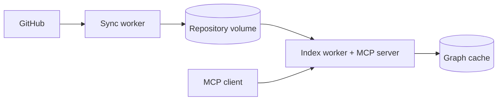

# Codebase Memory Server

A self-hosted Rust service that brings [Codebase Memory MCP](https://github.com/DeusData/codebase-memory-mcp) to teams. Synchronize GitHub repositories, maintain searchable code graphs, and let MCP-compatible clients explore code through one shared endpoint.

> **Development preview:** Deployment with real GitHub App credentials and production access controls has not yet been validated. The MCP endpoint has no built-in authentication.

## Features

- GitHub App synchronization of selected repositories on their `main` branches.
- Automatic indexing and configurable cross-repository analysis.
- Read-only MCP tools for code search and graph exploration.
- Streamable HTTP transport for MCP-compatible clients.
- Linux AMD64 and ARM64 container images.

## How it works



The two processes use the same image. Only the sync worker receives GitHub App credentials; the server reads the shared repository volume without write access.

## Getting started

Build from source, or pull the published image from Docker Hub once available.

```bash
git clone https://github.com/hohsiang-lab/codebase-memory-server.git
cd codebase-memory-server
docker build -t codebase-memory-server:local .
cp repos.example.json repos.json
```

Edit `repos.json` to select the repositories to index. Create a GitHub App with read-only Contents access, install it on the selected repositories, and prepare its credential files as described in the [configuration guide](docs/configuration.md).

Start the sync worker and MCP server using the [Docker setup instructions](docs/configuration.md#run-with-docker). Connect a Streamable HTTP MCP client to:

```text
http://127.0.0.1:8000/mcp
```

The readiness endpoint is `/healthz`. Initial indexing runs asynchronously; repositories become searchable as their indexes are built.

## Security

Run the service on a trusted private network or behind an authenticated gateway with appropriate authorization. All clients that can access the MCP endpoint can read every configured repository. Do not expose it directly to the internet.

See the [configuration guide](docs/configuration.md#security-boundary) for access boundaries, storage permissions and cache migration requirements.

## Development

Run `cargo test --locked` or build the container with Docker Buildx. See the [maintainer guide](docs/maintainers.md) for image publishing and validation.

## License

MIT. The upstream Codebase Memory MCP engine is also MIT-licensed; its license is included in the container image.
